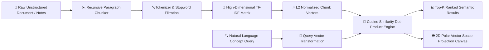

<div align="center">

  <h1>🧭 DocuVector AI</h1>
  <p><b>In-Browser High-Dimensional Vector Embeddings & Semantic Cosine Retrieval Engine</b></p>

  
  
  
  

  <br/><br/>

  <a href="https://krishnagupta-coder.github.io/DocuVector-AI/" target="_blank">
    
  </a>

</div>

---

### ⚡ Problem Statement
Keyword-matching search algorithms (like browser `Ctrl+F` or standard string grep) evaluate strictly identical characters. When users search for **conceptual meaning** (e.g. asking *"How does memory compression improve model latency?"* across a document using phrases like *"quantization minimizes memory bandwidth"*), traditional search returns zero hits.

**DocuVector AI** is a client-side semantic document intelligence engine created by [Krishna Gupta](https://github.com/KrishnaGupta-coder). It constructs a **high-dimensional vector space** from arbitrary text, applies sublinear TF-IDF term weighting, and executes instantaneous cosine similarity scoring with **interactive 2D vector space projection** running entirely in the client's browser with **zero backend servers and zero API costs**.

---

### 📐 Mathematical Formulation

The semantic proximity between the user query vector $\vec{q}$ and any document chunk vector $\vec{d}_i$ is computed via normalized dot-product cosine distance:

$$\text{Cosine Similarity}(\vec{q}, \vec{d}_i) = \frac{\vec{q} \cdot \vec{d}_i}{\|\vec{q}\|_2 \|\vec{d}_i\|_2} = \frac{\sum_{j=1}^{N} q_j \cdot d_{i,j}}{\sqrt{\sum_{j=1}^{N} q_j^2} \sqrt{\sum_{j=1}^{N} d_{i,j}^2}}$$

Where:
- $N$ represents the active corpus vocabulary dimension.
- Each weight incorporates Inverse Document Frequency: $\text{IDF}(t) = \ln\left(\frac{N_{docs} + 1}{DF(t) + 0.5}\right) + 1$.
- Vectors are $L_2$-normalized such that $\|\vec{v}\|_2 = 1.0$.

---

### 🛠️ Architecture & Pipeline



---

### ✨ Key Features

- **Sub-Millisecond In-Browser Vectorization**: Generates high-dimensional vector spaces and computes cosine scores across dozens of chunks in `< 2 ms`.
- **Interactive 2D Vector Radar**: Maps multi-dimensional chunk vectors and the query vector onto a 2D polar projection canvas, rendering real-time vector connection lines.
- **Dynamic Concept Highlighting**: Automatically detects and highlights relevant keyword tokens inside retrieved passages.
- **Pre-Loaded Multi-Domain Corpora**: 1-click test datasets for *AI & Machine Learning Research*, *Clinical Medical Trials*, and *Distributed Cloud Architecture*.

---

### 🚀 Running Locally

1. Clone this repository:
   ```bash
   git clone https://github.com/KrishnaGupta-coder/DocuVector-AI.git
   cd DocuVector-AI
   ```
2. Open `index.html` in any browser, or run via Python:
   ```bash
   python -m http.server 8000
   ```
3. Ingest documents and explore semantic similarity!

---

<div align="center">
  <sub>Developed by <b>Krishna Gupta</b> • Specialized in Vector Similarity & Machine Learning Systems • Jaipur, India</sub>
</div>
